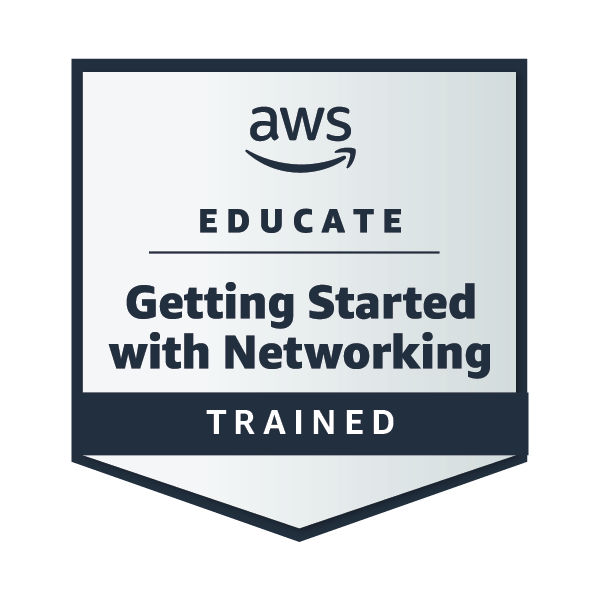

## ☁️ AWS Training & Achievements

I'm building my knowledge of cloud computing and networking through AWS Educate training.

### 🏅 AWS Educate — Getting Started with Networking

  

**Skills I'm developing:**
- Cloud networking fundamentals
- Understanding network infrastructure
- Learning core AWS concepts

  <a href="https://www.credly.com/badges/f6501757-ea43-4496-8d81-a5743ecb211a/public_url">View Badge on Credly</a>

